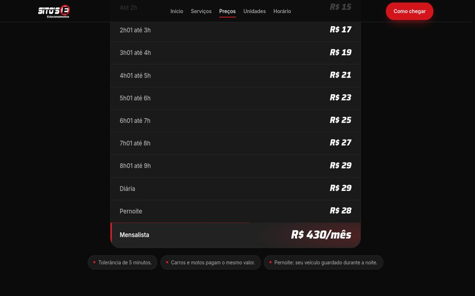
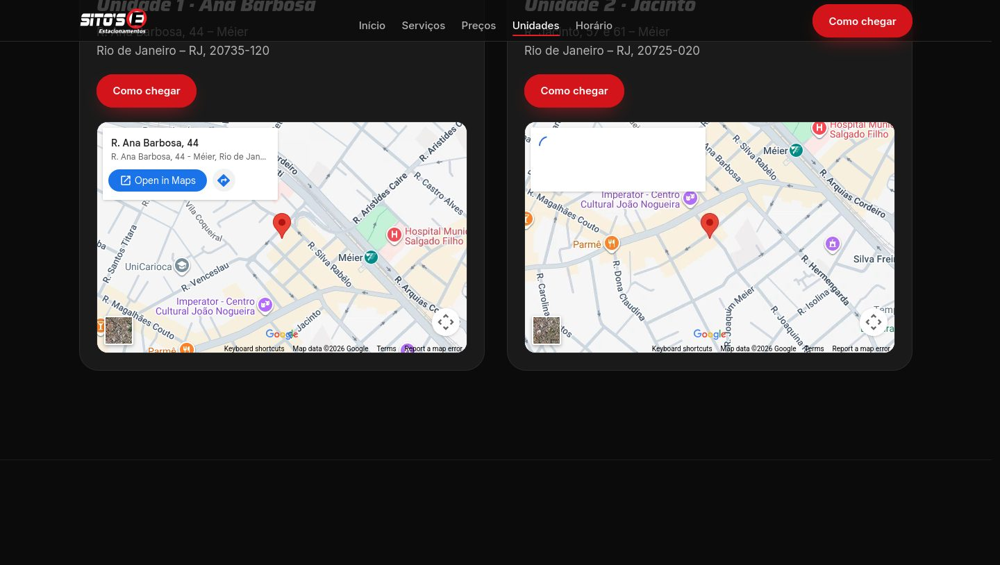
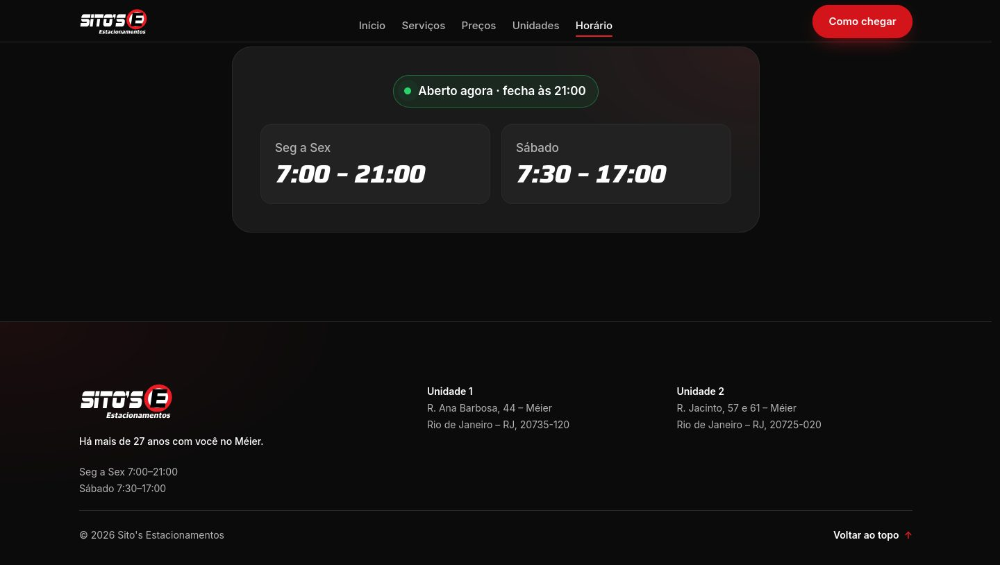

# Sito's Estacionamentos — Landing page

Landing page para o **Sito's Estacionamentos**, estacionamento de um cliente com duas unidades no Méier, Rio de Janeiro. O site apresenta o estacionamento, os preços de cada unidade, a localização com mapa e tour 360° e o horário de funcionamento.

🔗 **Site no ar:** https://diarooll.github.io/Sito-s-estacionamento/


## Destaques

- **Animações que rodam em qualquer máquina.** Em PCs fracos, o Windows costuma desligar os "efeitos de animação", o que ativa o `prefers-reduced-motion`. Muitos sites desligam tudo nesse caso e a página fica estática. Aqui as animações continuam em versão curta (fades e escala), e a página nunca fica parada.
- **Modo leve automático.** O site mede o FPS no primeiro segundo e verifica o hardware (núcleos e memória). Em máquina fraca, desliga só os efeitos pesados (tilt 3D, parallax, `backdrop-filter`) e mantém o resto.
- **Animações leves.** Só `transform` e `opacity` são animados. Não há listeners pesados de scroll: as animações usam `IntersectionObserver` e `requestAnimationFrame`, e as que se repetem pausam fora da tela.
- **Hero em tela cheia** com o símbolo da marca em parallax, rastros de luz de faróis e fade para destacar o texto.
- **Status "Aberto agora / Fechado agora"** calculado no fuso de São Paulo e atualizado a cada minuto.
- **Mapas e tour 360°** (Google Maps e Street View) carregados só quando aparecem na tela.
- **Funciona sem JavaScript.** O conteúdo aparece mesmo sem JS (progressive enhancement), e um timeout de segurança revela tudo se algum script falhar.
- **Módulos isolados.** Cada módulo JS é carregado com `import()` dentro do próprio `try/catch`, então um erro em um não derruba os outros.
- **Sem cache antigo.** Os CSS e JS têm versão na URL (`?v=`), e um `importmap` aplica a versão também nos imports entre módulos. O script `scripts/versao.sh` atualiza tudo antes de publicar.
- **SEO local.** Metatags, Open Graph e JSON-LD `ParkingFacility` para cada unidade, com endereço, coordenadas, horário e faixa de preço.
- **Acessível e responsivo.** HTML semântico, abas com ARIA e navegação por setas, foco visível, skip-link, contraste AA e layout mobile-first sem rolagem lateral.

## Tecnologias

- **HTML5, CSS3 e JavaScript (ES modules) puros**, sem frameworks, bibliotecas ou etapa de build
- Web Animations API, IntersectionObserver, `requestAnimationFrame` e `Intl` (fuso horário)
- Google Fonts (Saira e Inter) e embeds do Google Maps/Street View
- GitHub Pages para hospedagem
- **Ferramentas de IA:** o desenvolvimento usou o Claude Code (Anthropic). Eu planejei e direcionei o projeto, defini os requisitos com o cliente e revisei cada entrega. A implementação foi feita por agentes de IA especializados em HTML, CSS e JavaScript, que trabalharam em paralelo e se coordenaram por um contrato compartilhado ([`docs/CONTRATO.md`](docs/CONTRATO.md)) com os nomes de classes, atributos e decisões do projeto.

## Telas

| Serviços | Preços |
|---|---|
|  |  |

| Unidades | Horário e rodapé |
|---|---|
|  |  |

| Celular — hero | Celular — preços |
|---|---|
|  |  |

## Estrutura

```
index.html            página única
css/
  base.css            tokens de cor, reset e tipografia
  layout.css          header, footer, grids
  components.css      botões, cards, abas, tabela
  sections.css        hero, preços, unidades, tour, horário
  animations.css      reveals, faixas de luz, modos reduced/lite
js/
  main.js             carrega cada módulo de forma isolada
  modules/            motion, header, hero, reveal, counters, tabs,
                      scrollspy, cards, maps, hours
assets/               logo em SVG, ícones e imagem de compartilhamento
scripts/versao.sh     atualiza a versão dos arquivos (cache-busting)
docs/CONTRATO.md      contrato entre os agentes (HTML/CSS/JS)
```

## Como rodar localmente

Os módulos JS não funcionam abrindo o arquivo direto (`file://`), então é preciso um servidor local:

```bash
python3 -m http.server 8080
# depois abra http://localhost:8080
```

Também funciona com a extensão **Live Server** do VS Code ("Go Live").

Antes de publicar uma mudança de CSS ou JS:

```bash
./scripts/versao.sh
```
